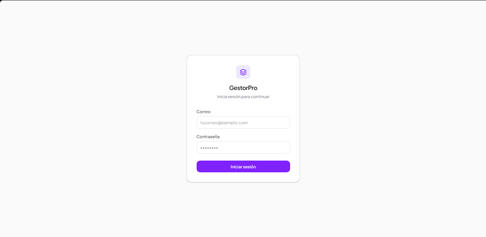
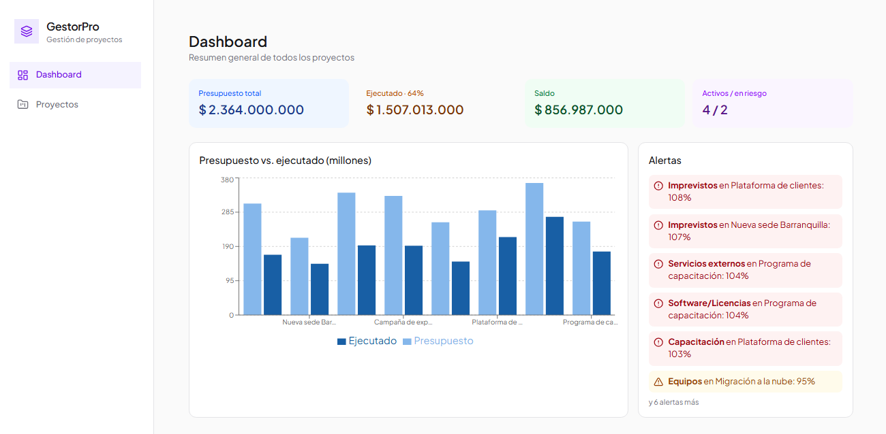
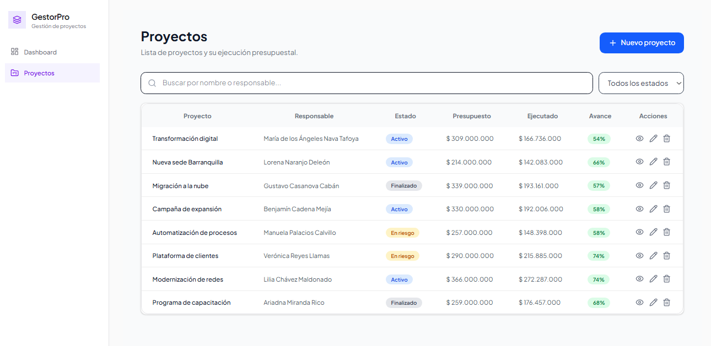
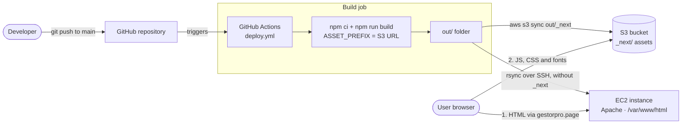

# GestorPro

A **project tracking** web application for companies and corporations. It shows the budget, the amount spent and the remaining balance of each project, item by item, and lets you record expenses that update the totals and trigger alerts instantly.

**Live demo:** [https://gestorpro.page](https://gestorpro.page)

---

## Screenshots

### Login

Entry screen of the application. It is a visual login only: it does not validate credentials yet (see [Current status](#current-status)).



### Dashboard

Overview with cards for total budget, amount spent, balance and active or at-risk projects, a budget vs. spent chart per project, and an alerts panel.



### Projects list

Table with search, a status filter, and actions to view, edit and delete projects.



---

## Current status

| Part | Status |
|---|---|
| Login (`/login`) | Visual only: any input goes through to the dashboard, there are no real accounts yet |
| Dashboard (KPIs, bar chart and alerts) | Working, reads the shared data and reacts to new expenses |
| Projects list (search, filter, create, edit and delete) | Working, changes are reflected on the dashboard |
| Project detail (`/proyectos/[id]`) | Working, shows the real budget items of the selected project |
| Expense logging | Working, updates spent amount, balance, alerts and dashboard |
| Expense warning | Working, shows a message when an item moves into alert or overspent |
| Data persistence | Working, saved in the browser (`localStorage`), with a "Restablecer datos" button |
| Deployment | Static export served from AWS (EC2 + Apache + S3) |

### What it does today

- **Dashboard** with cards for total budget, amount spent, balance and active or at-risk projects, a budget vs. spent chart per project, and an alerts panel with the budget items that are at 85% or more.
- **Project management**: table with search by name or manager, a status filter, and create, edit and delete through a modal form (including the budget of each item).
- **Project detail**: budget, spent amount, balance and progress for each item, plus a form to register expenses.
- **Live alerts**: when an expense pushes an item to 85% or more (or over 100%), the detail page shows a warning and the dashboard alerts update on their own.
- **Persistence**: projects and expenses survive a page reload.
- **Simulated data** generated with Faker, in Colombian pesos (COP).

The budget items of each project are: Personal (staff), Equipos (equipment), Software/Licencias (software and licenses), Servicios externos (external services), Viáticos (travel expenses), Capacitación (training) and Imprevistos (contingencies).

### Pending

- Real authentication (accounts and sessions) and a backend with a database.
- Per-item charts and monthly execution in the detail view.
- Links from each dashboard alert to its project.
- Projects created by the user are not pre-rendered by the static export, so opening their address directly after a reload returns a 404 (see [Known limitations](#known-limitations)).

## Tech stack

| Tool | Purpose |
|---|---|
| [Next.js 16](https://nextjs.org/) (App Router) | Framework and routing, static export (`output: 'export'`) |
| [React 19](https://react.dev/) + TypeScript | UI and typing |
| [Tailwind CSS 4](https://tailwindcss.com/) | Styling |
| [Recharts](https://recharts.org/) | Charts |
| [Zustand](https://zustand-demo.pmnd.rs/) (`persist` middleware) | State shared between pages, saved in `localStorage` |
| [@faker-js/faker](https://fakerjs.dev/) | Simulated data |
| [lucide-react](https://lucide.dev/) | Icons |
| [AWS EC2](https://aws.amazon.com/ec2/) + [Apache](https://httpd.apache.org/) | Serves the HTML pages |
| [AWS S3](https://aws.amazon.com/s3/) | Serves the static assets (`_next/`) |
| [GitHub Actions](https://docs.github.com/actions) | Automatic build and deployment on every push to `main` |

## Routes

| Route | Description |
|---|---|
| `/` | Redirects to `/login` |
| `/login` | Login screen (visual only) |
| `/dashboard` | Overview, chart and alerts |
| `/proyectos` | Projects list with search, filter and CRUD |
| `/proyectos/[id]` | Project detail with budget items and expense logging |

## Running locally

Requirements: [Node.js](https://nodejs.org/) 20 or higher and Git.

```bash
# 1. Clone the repository
git clone https://github.com/ChrisAltF4/Gestionador-de-proyectos.git
cd Gestionador-de-proyectos

# 2. Install dependencies
npm install

# 3. Start the development server
npm run dev
```

Open [http://localhost:3000](http://localhost:3000) in your browser.

To create the production build (static files in `out/`):

```bash
npm run build
```

## Project structure

```
.
├── .github/
│   └── workflows/
│       └── deploy.yml               # Build + deploy to S3 and EC2
├── app/
│   ├── layout.tsx                   # Root layout (font and metadata)
│   ├── page.tsx                     # Redirects to /login
│   ├── login/page.tsx               # Login screen (visual only)
│   └── (dashboard)/
│       ├── layout.tsx               # Sidebar + content
│       ├── dashboard/page.tsx       # Dashboard
│       └── proyectos/
│           ├── page.tsx             # Projects list
│           └── [id]/page.tsx        # Project detail route (generateStaticParams)
├── components/
│   ├── sidebar.tsx                  # Side menu
│   ├── kpiCard.tsx                  # KPI card
│   ├── statusBadge.tsx              # Project status chip
│   ├── progressBar.tsx              # Progress bar
│   ├── projectform.tsx              # Project form (create / edit)
│   ├── projectDetail.tsx            # Detail view: items, totals and warnings
│   ├── expenseForm.tsx              # Expense form
│   ├── storeHydratation.tsx         # Loads the saved data from localStorage
│   └── resetButton.tsx              # "Restablecer datos" button
├── lib/
│   ├── types.ts                     # Types (Proyecto, Gasto, Rubro, Nivel)
│   ├── faker-data.ts                # Data generation with Faker
│   ├── store.ts                     # Global state (Zustand + persist)
│   └── utils.ts                     # COP formatting and calculations
├── public/
│   └── Screenshots/                 # README screenshots
└── next.config.ts                   # Static export and S3 asset prefix
```

## How the data works

- Projects are generated with **Faker** using a fixed seed (`faker.seed(123)`), so everyone sees the same initial data when opening the app.
- The **spent amount** and the **balance** are not stored, they are calculated:
  - Spent amount of an item = sum of the expenses of that item.
  - Balance = item budget − spent amount.
- Amounts are displayed in Colombian pesos using `Intl.NumberFormat("es-CO")`.
- Alert levels are: **normal** (under 85%), **warning** (85% or more) and **overspent** (over 100%).
- The store is saved in the browser under the `gestorpro-store` key (`version: 1`). If the shape of the data changes, raise the version so old saved data is discarded instead of breaking the app. The **Restablecer datos** button goes back to the initial Faker data.

> **Note:** the project has no backend or database. Data lives in each browser's `localStorage`, so what one person registers is not visible to another, and each address (domain, S3 URL, local) keeps its own data.

## Deployment on AWS

The app is exported as a static site (`output: 'export'`) and split in two places: the HTML pages are served by **Apache on an EC2 instance**, and the heavy static assets (`_next/`) are served from an **S3 bucket**.



| Component | Role |
|---|---|
| **GitHub Actions** | On every push to `main` (or manually) it installs, builds and deploys |
| **Build** | `npm run build` with `ASSET_PREFIX=https://<bucket>.s3.us-east-1.amazonaws.com`, so the pages point to S3 for their assets |
| **S3** | Receives `out/_next/` with `aws s3 sync` and long-term cache headers (`max-age=31536000, immutable`) |
| **EC2 + Apache** | Receives the rest of `out/` (HTML and public files, without `_next/`) with `rsync` into `/var/www/html/` |
| **Domain** | `gestorpro.page` is the public address of the app |

### Secrets used by the workflow

Configured in the repository settings (*Settings → Secrets and variables → Actions*):

| Secret | Used for |
|---|---|
| `S3_BUCKET` | Name of the bucket with the assets |
| `AWS_ACCESS_KEY_ID`, `AWS_SECRET_ACCESS_KEY`, `AWS_SESSION_TOKEN` | AWS credentials to upload to S3 |
| `EC2_HOST`, `EC2_USER`, `EC2_SSH_KEY` | SSH access to copy the files to the instance |

### Known limitations

- Because the site is exported statically, `/proyectos/[id]` is only pre-rendered for the initial Faker projects (`p1` to `p8`). A project created by the user works while navigating inside the app, but opening its address directly or reloading it gives a 404.
- AWS Academy-style credentials include a session token that expires, so the `AWS_*` secrets have to be refreshed when they do.

## Team workflow

- `main`: stable, deployed version.
- `develop`: integration branch where the work is merged.
- `feature/...`: one branch per feature, merged into `develop` through a Pull Request.
- `fix/...`: bug fixes.

Commit messages follow the `type: description` format (`feat`, `fix`, `style`, `chore`, `docs`, `refactor`, `ci`).

Every push to `main` is automatically built and deployed to AWS by GitHub Actions.

## Team

| Member | Responsibility |
|---|---|
| _Christian_ | Data and logic (`lib/`), data persistence (Zustand `persist`, reset button), dashboard, domain and AWS deployment |
| _Fiorella_ | Layout, sidebar and shared components |
| _Luis_ | Projects list (search, filter, CRUD) and removal of the executed and progress columns |
| _Alejandro_ | Project detail, expense logging and the warning when an item reaches alert level |

---
