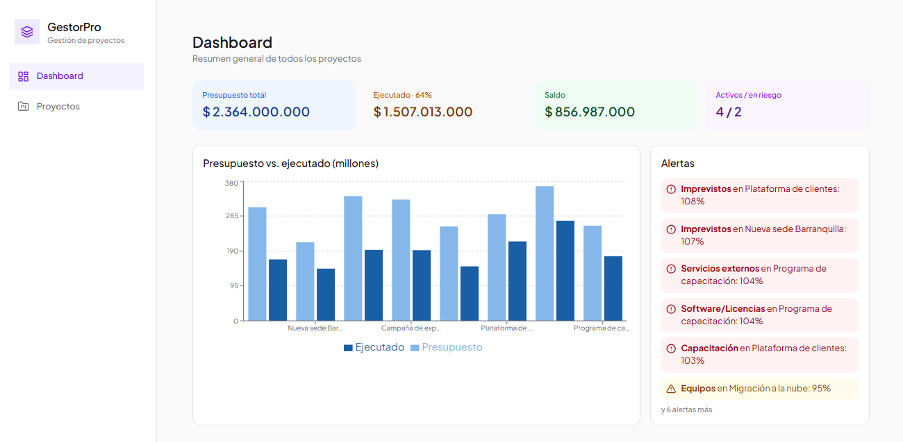
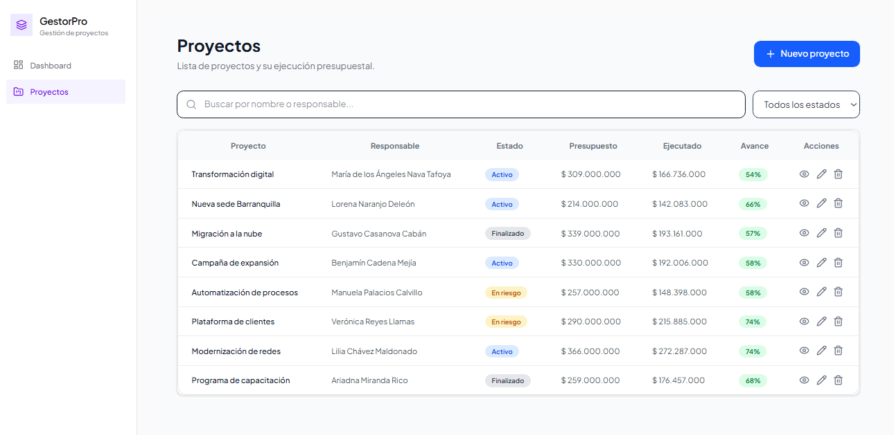

# GestorPro

Aplicación web de **seguimiento de proyectos** para empresas y corporaciones. Permite ver el presupuesto, lo ejecutado y el saldo de cada proyecto, rubro por rubro, y registrar gastos que actualizan los totales al instante.

**Demo en vivo:** [https://gestorpro.page](https://gestorpro.page)

---

## Capturas de pantalla

### Dashboard

Resumen general con tarjetas de presupuesto total, ejecutado, saldo y proyectos activos o en riesgo, un gráfico de presupuesto vs. ejecutado por proyecto y un panel de alertas.



### Lista de proyectos

Tabla con buscador, filtro por estado, avance de ejecución y acciones para ver, editar y eliminar proyectos.



---

## Funcionalidades

- **Dashboard** con indicadores clave (KPI), gráfico de barras y alertas de rubros con más del 85 % ejecutado o sobreejecutados.
- **Gestión de proyectos** (crear, ver, editar y eliminar) con buscador y filtro por estado.
- **Detalle de proyecto** con tabla rubro por rubro: presupuestado, ejecutado, saldo y porcentaje de ejecución, con fila de totales.
- **Registro de gastos** por rubro: el ejecutado, el saldo y las alertas se recalculan al instante.
- **Datos simulados** con Faker, en pesos colombianos (COP).

Los rubros que maneja cada proyecto son: Personal, Equipos, Software/Licencias, Servicios externos, Viáticos, Capacitación e Imprevistos.

## Tecnologías

| Herramienta | Uso |
|---|---|
| [Next.js 16](https://nextjs.org/) (App Router) | Framework y enrutamiento |
| [React](https://react.dev/) + TypeScript | Interfaz y tipado |
| [Tailwind CSS](https://tailwindcss.com/) | Estilos |
| [Recharts](https://recharts.org/) | Gráficos |
| [Zustand](https://zustand-demo.pmnd.rs/) | Estado compartido entre páginas |
| [@faker-js/faker](https://fakerjs.dev/) | Datos simulados |
| [lucide-react](https://lucide.dev/) | Íconos |
| [Vercel](https://vercel.com/) | Despliegue |

## Rutas

| Ruta | Descripción |
|---|---|
| `/` | Redirige a `/dashboard` |
| `/dashboard` | Resumen general, gráfico y alertas |
| `/proyectos` | Lista de proyectos con CRUD |
| `/proyectos/[id]` | Detalle del proyecto, rubros y registro de gastos |

## Cómo ejecutarlo en local

Requisitos: [Node.js](https://nodejs.org/) 20 o superior y Git.

```bash
# 1. Clonar el repositorio
git clone https://github.com/ChrisAltF4/Gestionador-de-proyectos.git
cd Gestionador-de-proyectos

# 2. Instalar dependencias
npm install

# 3. Iniciar el servidor de desarrollo
npm run dev
```

Abre [http://localhost:3000](http://localhost:3000) en el navegador.

Para generar la versión de producción:

```bash
npm run build
npm start
```

## Estructura del proyecto

```
.
├── app/
│   ├── layout.tsx                   # Layout raíz
│   ├── page.tsx                     # Redirige a /dashboard
│   └── (dashboard)/
│       ├── layout.tsx               # Menú lateral + contenido
│       ├── dashboard/page.tsx       # Dashboard
│       └── proyectos/
│           ├── page.tsx             # Lista de proyectos
│           └── [id]/page.tsx        # Detalle del proyecto
├── components/
│   ├── sidebar.tsx                  # Menú lateral
│   ├── kpiCard.tsx                  # Tarjeta de indicador
│   ├── statusBadge.tsx              # Chip de estado
│   ├── progressBar.tsx              # Barra de avance
│   ├── projectform.tsx              # Formulario de proyecto
│   └── expenseForm.tsx              # Formulario de gasto
├── lib/
│   ├── types.ts                     # Tipos (Proyecto, Gasto, rubros)
│   ├── faker-data.ts                # Generación de datos con Faker
│   ├── store.ts                     # Estado global (Zustand)
│   └── utils.ts                     # Formato COP y cálculos
└── public/
    └── screenshots/                # Capturas del README
```

## Cómo funcionan los datos

- Los proyectos se generan con **Faker** usando una semilla fija (`faker.seed(123)`), así que todos ven los mismos datos al abrir la página.
- El **ejecutado** y el **saldo** no se guardan: se calculan.
  - Ejecutado de un rubro = suma de los gastos de ese rubro.
  - Saldo = presupuesto del rubro − ejecutado.
- Los valores se muestran en pesos colombianos con `Intl.NumberFormat("es-CO")`.
- Los niveles de alerta son: **normal** (menos de 85 %), **alerta** (85 % o más) y **sobreejecución** (más de 100 %).

> **Nota:** el proyecto no tiene backend ni base de datos. Los cambios (crear, editar, eliminar proyectos y registrar gastos) viven en el navegador y se pierden al recargar la página, que vuelve a los datos iniciales de Faker.

## Flujo de trabajo del equipo

- `main`: versión estable y desplegada.
- `develop`: rama de integración donde se une el trabajo.
- `feature/...`: una rama por funcionalidad, que se une a `develop` con Pull Request.
- `fix/...`: correcciones.

Los mensajes de commit siguen el formato `tipo: descripción` (`feat`, `fix`, `style`, `chore`, `docs`, `refactor`).

Cada push a `main` se despliega automáticamente en Vercel.

## Equipo

| Integrante | Responsabilidad |
|---|---|
| _Nombre_ | Datos y lógica (`lib/`) |
| _Nombre_ | Layout, menú lateral y componentes comunes |
| _Nombre_ | Lista de proyectos |
| _Nombre_ | Detalle de proyecto y registro de gastos |
| _Nombre_ | Dashboard |

---

Proyecto académico desarrollado con Next.js.
